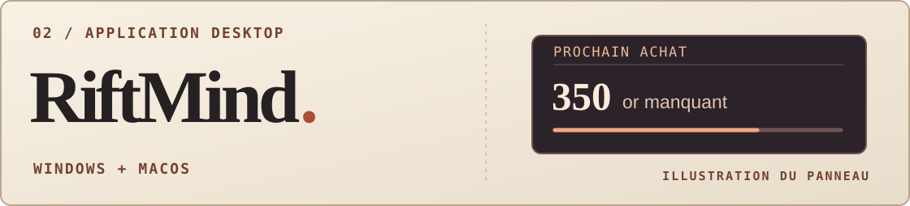

**Étudiant en informatique à l’EPITA, je cherche une opportunité en cybersécurité.** Ce qui m’intéresse : partir d’une alerte, retrouver les faits et savoir quelle vérification faire ensuite.

[Voir le labo ↓](#01--une-connexion-à-examiner) · [Découvrir RiftMind ↓](#02--une-application-à-essayer) · [Me contacter sur LinkedIn ↗](https://www.linkedin.com/in/nicolas-jaumotte-71743a399/)

## 01 · Une connexion à examiner

**Cinq refus, puis un accès. Quelqu’un s’est-il simplement trompé de mot de passe ?** Dans ce labo, un détecteur Python signale cette séquence sur des journaux fictifs. Le rapport explique comment faire la différence entre une alerte et un indice de compromission.

[Lire le rapport ↗](https://github.com/NicolasJaumotte/ssh-auth-triage#rapport-de-triage) · [Voir le code Python ↗](https://github.com/NicolasJaumotte/ssh-auth-triage/blob/main/lab.py)

Comment le détecteur relie les événements

Il compte les échecs des 120 dernières secondes pour le même serveur, la même adresse source et le même compte. Si une connexion réussit après au moins cinq échecs, il signale la séquence. Le rapport propose ensuite de vérifier la méthode de connexion et ce qui s’est passé après l’accès.

## 02 · Une application à essayer

**RiftMind** est une application compagnon pour League of Legends. Elle propose des builds et des runes avant le match. Pendant la partie, le joueur peut déplacer ou masquer les panneaux qui lui indiquent, par exemple, l’or manquant pour son prochain achat.

[Voir les versions et télécharger ↗](https://github.com/njaumotte/riftmind/releases/latest)

---

**Ce que le labo met en pratique :** Python, analyse de journaux, tests et rédaction d’un rapport de triage.  
**Pour échanger :** [Nicolas Jaumotte sur LinkedIn ↗](https://www.linkedin.com/in/nicolas-jaumotte-71743a399/)
