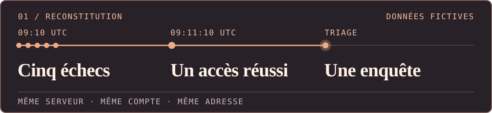

**Je cherche un stage, une alternance ou un premier poste en cybersécurité.** Ce qui m’intéresse : remonter d’une alerte aux faits, puis expliquer ce qu’on peut en conclure.

[Voir l’enquête ↓](#01--du-journal-à-lenquête) · [Essayer RiftMind ↓](#02--du-code-à-lapplication) · [Me contacter sur LinkedIn ↗](https://www.linkedin.com/in/nicolas-jaumotte-10b63a449/)

## 01 · Du journal à l’enquête

**Est-ce que quelqu’un a simplement oublié son mot de passe ?** Dans [SSH Auth Triage](https://github.com/NicolasJaumotte/ssh-auth-triage), un script Python repère cette séquence sur un serveur fictif. Le rapport explique ce qu’il faudrait vérifier avant de conclure à une intrusion. SSH sert à se connecter à un serveur à distance.

[Lire le rapport de triage ↗](https://github.com/NicolasJaumotte/ssh-auth-triage#rapport-de-triage) · [Voir le détecteur Python ↗](https://github.com/NicolasJaumotte/ssh-auth-triage/blob/main/lab.py)

## 02 · Du code à l’application

**RiftMind** est une application pour League of Legends sur Windows et macOS. Avant la partie, elle affiche des builds et des runes. En jeu, un panneau personnalisable indique, par exemple, combien d’or il manque pour le prochain achat.

[Télécharger RiftMind ↗](https://github.com/njaumotte/riftmind/releases/latest)
