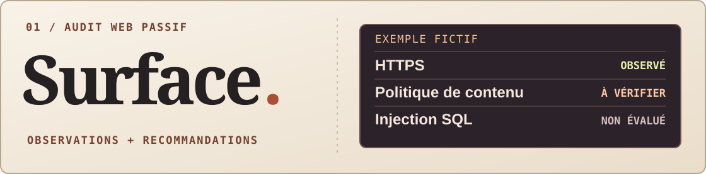

**Étudiant en informatique à l’EPITA, je cherche une opportunité en cybersécurité.** Ce qui m’intéresse : partir d’une alerte, retrouver les faits et savoir quelle vérification faire ensuite.

[Découvrir Surface ↓](#01--surface-audit-web-passif) · [Découvrir RiftMind ↓](#02--une-application-à-essayer) · [Me contacter sur LinkedIn ↗](https://www.linkedin.com/in/nicolas-jaumotte-71743a399/)

## 01 · Surface, audit web passif

**Entre un domaine : que faut-il vérifier en priorité ?** Surface lit les réponses de la page d’accueil et transforme ce qu’il observe — HTTPS, en-têtes et cookies — en recommandations. Il explique aussi où le contrôle s’arrête : une injection SQL se vérifie côté code ou dans un environnement de test autorisé.

[Découvrir Surface et lire un exemple de rapport ↗](https://github.com/NicolasJaumotte/surface-audit)

## 02 · Une application à essayer

**RiftMind** est une application compagnon pour League of Legends. Elle propose des builds et des runes avant le match. Pendant la partie, le joueur peut déplacer ou masquer les panneaux qui lui indiquent, par exemple, l’or manquant pour son prochain achat.

[Voir les versions et télécharger ↗](https://github.com/njaumotte/riftmind/releases/latest)

---

**Ce que je pratique :** analyse de réponses HTTP, tests et rédaction de recommandations.  
**Pour échanger :** [Nicolas Jaumotte sur LinkedIn ↗](https://www.linkedin.com/in/nicolas-jaumotte-71743a399/)
