**Étudiant en informatique à l’EPITA, je me spécialise en cybersécurité défensive.** Ce qui m’intéresse : partir d’une alerte, retrouver les faits et savoir quelle vérification faire ensuite. Je code en **C**, **C#** et **Python**.

**Surface** lit les réponses HTTP d’une page d’accueil — HTTPS, HSTS, CSP, cookies, CORS — et les transforme en recommandations classées. Il dit aussi où le contrôle s’arrête : une injection SQL se vérifie dans le code. → [Code, tests et exemple de rapport](https://github.com/NicolasJaumotte/surface-audit)

**OCR Word Search Solver** — projet de groupe EPITA (S3, en C). Le logiciel prend la photo d’une grille de mots cachés et rend la grille résolue. **Ma part :** le découpage de l’image en lettres (grille et liste de mots) et le réseau de neurones qui reconnaît chaque lettre, entraîné par rétropropagation, avec sauvegarde et rechargement de l’apprentissage. *Code privé : projet en cours.*

**Survivors** — jeu de survie contre des vagues de zombies, réalisé en groupe sous **Unity / C#** (projet EPITA S2). **Ma part :** le joueur et les armes, le multijoueur en réseau, les menus, le HUD et les niveaux.

**RiftMind** est une application compagnon pour League of Legends : builds et runes avant la partie, panneaux déplaçables pendant le match. → [Télécharger pour Windows ou macOS](https://github.com/njaumotte/riftmind/releases/latest)

---

**Pour échanger :** [Nicolas Jaumotte sur LinkedIn ↗](https://www.linkedin.com/in/nicolas-jaumotte-71743a399/)
