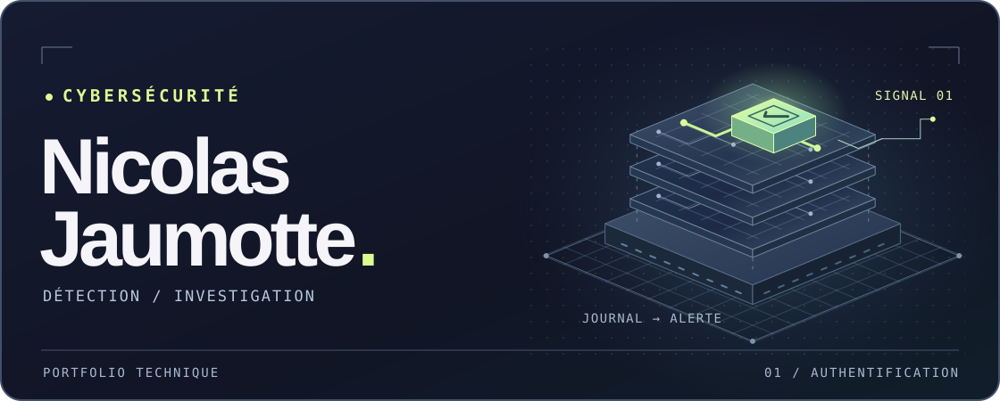

Je cherche un **stage, une alternance ou un premier poste en cybersécurité**. Ce qui m’intéresse : remonter d’une alerte aux faits, puis expliquer ce qu’on peut en conclure.

## 01 · Enquête sur une connexion SSH

**Cinq échecs, puis une connexion réussie. Est-ce suspect ?**

[SSH Auth Triage](https://github.com/NicolasJaumotte/ssh-auth-triage) est un exercice sur des **données fictives**. SSH sert à se connecter à un serveur à distance. Dans le labo, un script Python repère une séquence inhabituelle ; le rapport propose des vérifications pour savoir si la connexion était légitime.

[Lire le rapport](https://github.com/NicolasJaumotte/ssh-auth-triage#rapport-de-triage) · [Voir le code Python](https://github.com/NicolasJaumotte/ssh-auth-triage/blob/main/lab.py)

## 02 · Un produit à essayer

**[RiftMind](https://github.com/njaumotte/riftmind/releases/latest)** est une application Windows et macOS pour League of Legends. Elle propose des builds et des runes avant la partie, puis affiche des informations comme l’or manquant pour le prochain achat dans un panneau personnalisable.

---

**[Me contacter sur LinkedIn ↗](https://www.linkedin.com/in/nicolas-jaumotte-10b63a449/)**
