**Étudiant en informatique à l’EPITA, je cherche un stage ou une alternance en cybersécurité défensive.** Ce qui m’intéresse : partir d’une alerte, retrouver les faits et savoir quelle vérification faire ensuite.

**Surface** lit les réponses HTTP d’une page d’accueil — HTTPS, HSTS, CSP, cookies, CORS — et les transforme en recommandations classées. Il dit aussi où le contrôle s’arrête : une injection SQL se vérifie dans le code. → [Code, tests et exemple de rapport](https://github.com/NicolasJaumotte/surface-audit)

**SSH Auth Triage** est une mini-enquête sur un serveur fictif : cinq mots de passe refusés, puis une connexion acceptée. Le script lève l’alerte ; le rapport explique quoi vérifier avant de parler de compromission. → [Lire le rapport de triage](https://github.com/NicolasJaumotte/ssh-auth-triage#rapport-de-triage)

**RiftMind** est une application compagnon pour League of Legends : builds et runes avant la partie, panneaux déplaçables pendant le match. → [Télécharger pour Windows ou macOS](https://github.com/njaumotte/riftmind/releases/latest)

---

`Python` · `analyse de journaux` · `en-têtes HTTP` · `OWASP` · `MITRE ATT&CK` · `tests automatisés`

**Pour échanger :** [Nicolas Jaumotte sur LinkedIn ↗](https://www.linkedin.com/in/nicolas-jaumotte-71743a399/)
